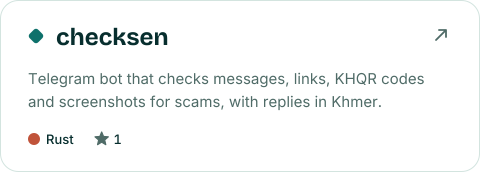
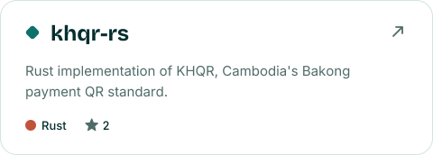
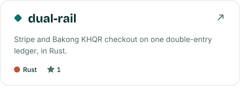
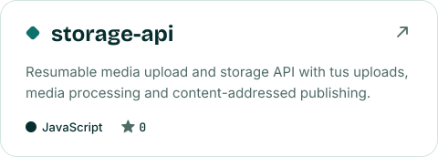

  

  I like building software that feels simple on the surface and solid underneath.

  
  &nbsp;
  

 

  <a href="https://github.com/tangheng05/checksen"><picture><source media="(prefers-color-scheme: dark)" srcset="assets/featured-checksen-dark.svg" /></picture></a>
  <a href="https://github.com/tangheng05/khqr-rs"><picture><source media="(prefers-color-scheme: dark)" srcset="assets/featured-khqr-rs-dark.svg" /></picture></a>
  <a href="https://github.com/tangheng05/dual-rail"><picture><source media="(prefers-color-scheme: dark)" srcset="assets/featured-dual-rail-dark.svg" /></picture></a>
  <a href="https://github.com/tangheng05/storage-api"><picture><source media="(prefers-color-scheme: dark)" srcset="assets/featured-storage-api-dark.svg" /></picture></a>

  <picture><source media="(prefers-color-scheme: dark)" srcset="assets/languages-dark.svg" /></picture>
  <picture><source media="(prefers-color-scheme: dark)" srcset="assets/stack-dark.svg" /></picture>

 

  

<!-- Graphics in assets/ are generated by scripts/generate.mjs and refreshed daily by .github/workflows/profile.yml. Edit config.json to change the text or featured repos. -->
